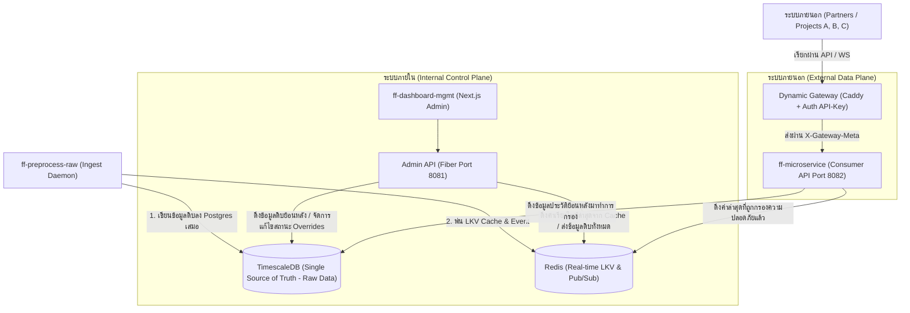

# แผนการจัดสรรสถาปัตยกรรมข้อมูลเรียลไทม์ (Internal Raw vs External Purified Data System Plan)

แผนงานนี้ได้รับการออกแบบตามความต้องการระดับ **Enterprise** เพื่อแยกขอบเขตข้อมูลภายในที่ต้องการเห็นข้อมูลดิบทั้งหมด (Internal Control Plane) ออกจากข้อมูลภายนอกที่ต้องผ่านการกรองความปลอดภัยและลดสัญญาณรบกวนออก (External Data Plane) โดย **ทั้งระบบภายในและภายนอกจะเข้าถึงผ่าน Redis Cache เพื่อความรวดเร็วระดับมิลลิวินาที** และมี **Postgres (TimescaleDB) เป็น Single Source of Truth ถาวร**

---

## 🏛️ สถาปัตยกรรมการแยกระบบแบบเด็ดขาด (Architectural Concerns Separation)

---

## 🛠️ แผนการดำเนินการเปรียบเทียบข้อมูลและการแยกโครงสร้าง (Proposed Plan)

- [ ] **1. การยืนยันความคงอยู่ของข้อมูลใน Postgres (Single Source of Truth)**
  - [x] ยืนยันว่าข้อมูลดิบทุกแถวที่อ่านจากไฟล์ CSV จะถูกเพิ่ม (Bulk Insert) เข้าตาราง `fahfon_current` ใน TimescaleDB เสมอ ไม่มีการสูญหายหรือลดทอนในฐานข้อมูลหลัก
  - [ ] ใช้ Redis เฉพาะเป็นตัวแคชข้อมูลล่าสุด (LKV - Last Known Value) และเป็นตัวกระจายเหตุการณ์ (Pub/Sub) เท่านั้น เพื่อแบ่งเบาภาระของฐานข้อมูล Postgres จากการเชื่อมต่อภายนอก

- [ ] **2. การนำ Redis Cache มาเพิ่มความเร็วให้ระบบภายใน (Internal Redis Cache - ff-dashboard-mgmt)**
  - [ ] จัดโครงสร้างคีย์แคชใน Redis เป็น 2 ส่วน เพื่อแยกระบบภายในและภายนอก:
    * **คีย์ข้อมูลดิบภายใน (`raw_telemetry:device_uuid`):** เก็บค่าเซนเซอร์ดิบทั้งหมดของอุปกรณ์ รวมถึงข้อมูลฮาร์ดแวร์เชิงลึก (`IMEI`, `secret_key`, ค่าลบผิดปกติอย่าง `-999.00`, และสถานะทางระบบ)
    * เมื่อหน้าบ้านแดชบอร์ดแอดมินหรือแผนที่ต้องการโหลดข้อมูลเรียลไทม์ของอุปกรณ์ทั้ง 3,000 เครื่อง -> Fiber Backend จะดึงจาก Redis คีย์ภายในนี้โดยตรง ทำให้แดชบอร์ดโหลดเสร็จภายใน **<10 มิลลิวินาที** โดยไม่ต้องรอ Postgres JOIN ตารางขนาดใหญ่
  - [ ] เมื่อแอดมินแก้ไขสถานะเครื่อง (Status Override) หรือขอดูดนสถิติประวัติย้อนหลังเชิงลึก -> Fiber Backend จะทำการคิวรี่ตรงไปยัง Postgres เพื่อยืนยันและแก้ไขค่าจริง

- [ ] **3. การกรองและคัดสรรข้อมูลบริสุทธิ์เพื่อระบบภายนอก (External Data Purification - ff-microservice)**
  - [ ] จัดโครงสร้างคีย์แคชสำหรับภายนอกแยกต่างหาก หรือให้ `ff-microservice` ดึงข้อมูลดิบจาก Redis/Postgres แล้วส่งผ่าน **Purification Pipeline (ตัวกรองข้อมูลบริสุทธิ์)**:
    * **กรองข้อมูลชำรุด (Sensor Anomalies Filter):** หากพบค่าแรงดันไฟแบตเตอรี่หรือความดันอากาศแสดงค่าติดลบที่ผิดปกติ เช่น `-999.00` ระบบจะแปลงค่านี้เป็น `null` หรือใช้ค่าเฉลี่ยทางสถิติแทน เพื่อให้ระบบภายนอกนำไปใช้งานโดยไม่ทำให้ระบบคำนวณปลายทางพัง
    * **ปกปิดข้อมูลสำคัญของฮาร์ดแวร์ (Security Stripping):** ตัดฟิลด์ข้อมูลระเบียบตัวตนทางกายภาพอย่าง `IMEI`, `Database Auto-Increment ID` หรือ `secret_key` ทิ้งทั้งหมด โดยระบบภายนอกจะเข้าถึงอุปกรณ์ผ่าน UUID สากล (`device_uuid`) เท่านั้น
    * **บังคับใช้การจำกัดขอบเขตข้อมูล (Row-level Security via Gateway Metadata):** ใช้ข้อมูลอีเมลสังกัดใน `X-Gateway-Meta` ที่ Caddy Gateway แนบมา ไปกรองคิวรี่ด้วยเงื่อนไข `WHERE email = $1` เพื่อให้ภายนอกเข้าถึงข้อมูลได้เฉพาะสถานีที่ได้รับอนุญาตจริงเท่านั้น

- [ ] **4. แผนเชื่อมต่อแบบ Real-time และการจัดการ Cache**
  - [ ] พัฒนา Middleware บน `ff-microservice` (Port 8082) เพื่อรองรับการเปิดเชื่อมต่อแบบ WebSockets / SSE สำหรับระบบภายนอกผ่าน Dynamic Gateway
  - [ ] เมื่อ Ingest Worker ได้รับข้อมูลจาก CSV -> อัปเดต LKV ลง Redis -> Redis จะส่งสัญญาณบอกต่อ Client ภายนอกที่เปิด WebSocket ไว้ทันที เพื่อส่งมอบข้อมูลที่สดใหม่ที่สุดไร้รอยต่อ

---

## 📈 แผนการทดสอบเพื่อความปลอดภัยและการตรวจสอบความถูกต้อง (Verification Plan)

### การทดสอบระบบภายใน (Internal)
* ตรวจสอบว่าแอดมินผ่าน `/dashboard` สามารถเห็นข้อมูลดิบทั้งหมดรวมถึงค่า `-999.00` และ `IMEI` ได้ครบถ้วนเพื่อใช้ในการบำรุงรักษา

### การทดสอบระบบภายนอก (External)
* ทดลองดึงข้อมูลผ่าน Endpoint `GET /api/v1/iot/devices/:uuid/telemetry` โดยส่ง API-Key ปลอมและจำลองสิทธิ์:
  * ยืนยันว่าไม่มีข้อมูล `IMEI` หลุดออกไป
  * ยืนยันว่าค่าเสียหายเช่น `-999.00` ถูกเปลี่ยนเป็น `null` หรือถูกคัดกรองออกอย่างสมบูรณ์แบบ
  * ยืนยันการทำงานของ Rate Limit (ทดสอบยิง API ถี่ๆ เพื่อเช็คว่าระบบบล็อกได้ถูกต้อง)
